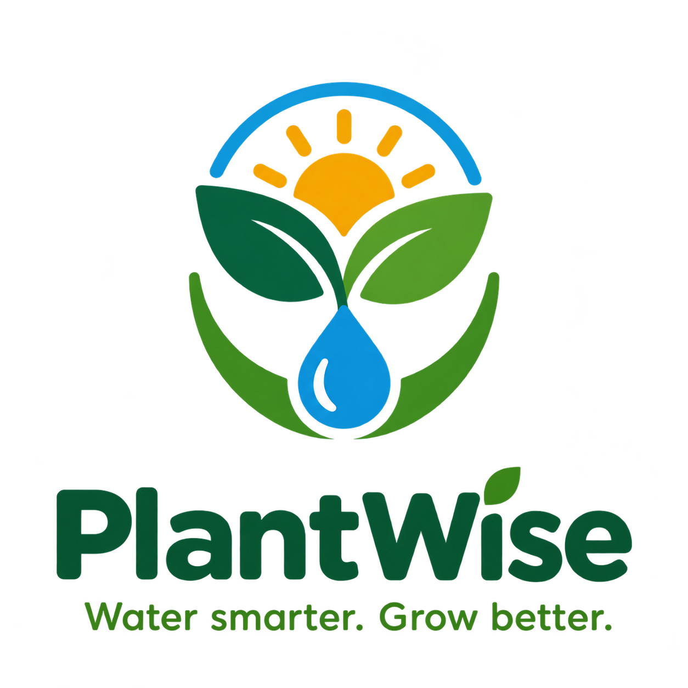

# Introduction

# PlantWise — Water smarter. Grow better. 

Do you know how much water your plants need in California's changing climate? Are you watering too much or too little based on the weather? PlantWise helps California gardeners make informed watering decisions based on their location, plant water requirements, and local weather conditions. 

# PlantWise can help you: 

Get personalized watering recommendations based on your ZIP code, selected plants, and local weather. 

Identify your climate zone using USDA Plant Hardiness Zone data and relevant California climate information. 

Discover plant-specific water needs using the WUCOLS database of California landscape plants. 

Understand recent weather conditions by analyzing rainfall and evapotranspiration to estimate environmental water loss. 

Plan upcoming watering using weather forecasts to help adjust recommendations as conditions change. 

Conserve water while growing healthier plants by making more informed watering decisions. 

Simply enter your California ZIP code, select your plants, and let PlantWise help you estimate how much water they need based on local conditions. Make every drop count with smarter, climate-aware plant care! 

# Icon/Logo 

 

# Requirements 

# 1. Take ZIP code as an input 

As a user, I want to enter my ZIP code so that I can receive watering estimates for my location. 

Given ZIP code “95814” is supported, when I enter “95814,” Then the app should identify Sacramento, California as my location. 

Given ZIP codes require five digits, When I enter “9581,” Then the app should display “Enter a valid five-digit ZIP code.” 

Given the ZIP code field is empty, When I submit the form, Then the app should display “ZIP code is required.” 

Given watering estimates are only supported for California, when I enter Ohio ZIP code “45236,” Then the app should explain that watering estimates are unavailable for that location. 

# 2. Take plants as input 

As a user, I want to search for and add my plants by common or scientific name so that I can get watering recommendations for each plant. 

Given Heteromeles arbutifolia (Toyon) is in the plant database, when I search for “Toyon”, then I should see “Heteromeles arbutifolia – Toyon” in the results. 

Given Salvia apiana (White Sage) and Salvia mellifera (Black Sage) are in the plant database, when I search for “Salvia”, then I should see both “White Sage” and “Black Sage” in the results. 

Given Eschscholzia californica (California Poppy) is in the plant database, when I search for “californica”, then I should see “Eschscholzia californica – California Poppy” in the results. 

Given no plant in the database matches “sklujapouetllkjsda”, when I search for “sklujapouetllkjsda”, then I should see zero results. 

Given I see “Heteromeles arbutifolia – Toyon” in my search results, When I click “Add to My Plants”, Then Toyon should appear in my plant list. 

Given Toyon is already in my plant list, when I try to add Toyon again, then I should see “Toyon is already in your list,” and it should only appear once. 

Given Toyon and California Poppy are in my plant list, when I click “Remove” next to California Poppy, then only Toyon should remain in my list. 

Given Symplocarpus foetidus (Eastern Skunk Cabbage) is not in the plant database, When I search for “Skunk Cabbage”, Then I should see the message “This plant is not in our California plant database.” 

# 3. Automatically gather Weather Data 

As a user, I want the zip code I entered to automatically pull weather data so that the expected water gain/loss in the soil can be translated into watering needs. 

Given “95814” is accepted as a valid zip code input, when I submit my query, then rainfall totals will be outputted. 

Given “95814” is accepted as a valid zip code input, When I submit my query, Then evapotranspiration totals will be outputted. 

Given only California zip codes are accepted, when I enter Ohio ZIP code “45236,” Then the validation rules will prevent the query prior to receiving weather data. 

# 4. Automatically calculate water needs 

As a user, once I input the zip code and plant, the system should automatically provide the water use needs. 

Given “94104” is accepted as a valid zip code input and “red maple” is accepted as a valid plant when I submit my query, then the system will identify this as a plant in region 1 requiring 40-60% of evapotranspiration replaced. 

Given “94104” is accepted as a valid ZIP code input, the plant requires 40-60% of evapotranspiration replaced, there has been no rain in San Francisco this week, and the weekly Evapotranspiration is 0.60”, then the system will output the appropriate amount of water to water is 0.30” of water. 

 

 

 

 

 

# Data sources 

USDA Plant Hardiness Zone Maps: 

https://planthardiness.ars.usda.gov/ 

(This translates to WUCOLS Sunset Climate Zones) 

Broken down by zip code 

Json API: https://phzmapi.org/ 

 

# WUCOLS Plant Database 

https://wucols.ucdavis.edu/plant-search-database 

This is California specific. There does not seem to be a national equivalent 

Dataset is a download to csv 

 

# NOAA Evapotranspiration 

NOAA website: 

https://www.weather.gov/ict/evapotranspiration 

API: 
https://open-meteo.com/en/docs/gfs-api?hourly=evapotranspiration 

 

# Database 

Our database will store plant information, location details, and weather data used to calculate watering needs. 

Plants table: Stores a plant ID, common name, and scientific name. 

Locations table: Stores ZIP code, latitude, longitude, USDA hardiness zone, and WUCOLS region. 

Plant Water Needs table: Stores the plant ID, WUCOLS region, and water-use rating or factor. Each plant can have different watering needs depending on the region. 

Weather table: Stores a weather record ID, ZIP code, date, evapotranspiration, and rainfall. Each location can have multiple daily weather records. 

The app will use the entered ZIP code to find the location and its region. It will then combine the selected plant’s regional water-use information with that location’s weather data to calculate an estimated watering need. 

 

# Team Composition 

As a team, we plan to conduct our standup every week Friday afternoons before our Seminar as a regularly scheduled MS Teams call. 

Gabe Guyler 

Guillermo Del Rio Gonzalez 

Aayusha Pandit 

Marcus Sheppard 
