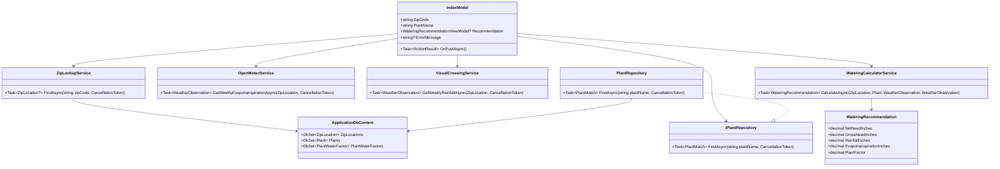

# PlantWise Data Model and Class Design

## Domain entities

### ZipLocation

Represents a supported five-digit ZIP code and its weather lookup coordinates.

| Field | Type | Constraints |
|---|---|---|
| Id | int | Primary key |
| ZipCode | string(5) | Required; unique; exactly five digits |
| Latitude | decimal(9,6) | Required; valid latitude range |
| Longitude | decimal(9,6) | Required; valid longitude range |
| TimeZoneId | string(64) | Required; IANA time-zone identifier |

### Plant

Represents a searchable plant in the local dataset.

| Field | Type | Constraints |
|---|---|---|
| Id | int | Primary key |
| CommonName | string(200) | Required |
| ScientificName | string(200) | Required |
| SearchName | string(200) | Required normalized search value |
| IsActive | bool | Required; inactive records are not selectable |

### PlantWaterFactor

Represents the plant factor used for the calculation.

| Field | Type | Constraints |
|---|---|---|
| Id | int | Primary key |
| PlantId | int | Required foreign key to Plant |
| Factor | decimal(5,4) | Required; inclusive range 0.0000 to 1.0000 |
| SourceRegion | string(100) | Required source or region label |

A plant has one selectable factor for this feature. If the imported source contains
multiple applicable records, the import process MUST resolve them explicitly or mark the
plant ambiguous so the application never chooses arbitrarily.

### WateringRecommendation

A request-scoped result object, not persisted in the first release.

| Field | Type | Constraints |
|---|---|---|
| ZipCode | string(5) | Required |
| PlantId | int | Required |
| PlantDisplayName | string | Required |
| PeriodStart | DateOnly | Required |
| PeriodEnd | DateOnly | Required; seven complete local calendar days |
| TimeZoneId | string | Required |
| EvapotranspirationInches | decimal | Required; non-negative |
| RainfallInches | decimal | Required; non-negative |
| PlantFactor | decimal | Required; 0 to 1 |
| GrossNeedInches | decimal | Required; ET × factor |
| NetNeedInches | decimal | Required; max(0, gross need - rainfall) |
| WeatherSources | collection | Required source labels and retrieval metadata |

## Relationships

- `Plant` 1-to-1 `PlantWaterFactor` for the selectable release dataset.
- `ZipLocation` is independently resolved by `ZipLookupService`.
- `WateringCalculatorService` combines one `ZipLocation`, one `Plant`, one
  `PlantWaterFactor`, and two normalized weather observations.
- No user or recommendation history is persisted in this feature.

## SQL Server LocalDB schema

```sql
CREATE TABLE ZipLocations (
	Id int IDENTITY PRIMARY KEY,
	ZipCode char(5) NOT NULL UNIQUE,
	Latitude decimal(9,6) NOT NULL,
	Longitude decimal(9,6) NOT NULL,
	TimeZoneId varchar(64) NOT NULL,
	CONSTRAINT CK_ZipLocations_ZipCode CHECK (ZipCode NOT LIKE '%[^0-9]%')
);

CREATE TABLE Plants (
	Id int IDENTITY PRIMARY KEY,
	CommonName nvarchar(200) NOT NULL,
	ScientificName nvarchar(200) NOT NULL,
	SearchName nvarchar(200) NOT NULL,
	IsActive bit NOT NULL DEFAULT 1
);

CREATE TABLE PlantWaterFactors (
	Id int IDENTITY PRIMARY KEY,
	PlantId int NOT NULL UNIQUE,
	Factor decimal(5,4) NOT NULL,
	SourceRegion nvarchar(100) NOT NULL,
	CONSTRAINT FK_PlantWaterFactors_Plants FOREIGN KEY (PlantId)
		REFERENCES Plants(Id),
	CONSTRAINT CK_PlantWaterFactors_Factor CHECK (Factor >= 0 AND Factor <= 1)
);

CREATE INDEX IX_Plants_SearchName ON Plants(SearchName);
CREATE INDEX IX_Plants_CommonName ON Plants(CommonName);
```

EF Core migrations MUST create these constraints and seed/import data through a
repeatable process. Imported rows MUST be validated before becoming selectable.

## Service and class diagram



The existing root `classDiagram.mmd` can be reconciled with this design during
implementation; the planned service names and weekly contract above are authoritative.
